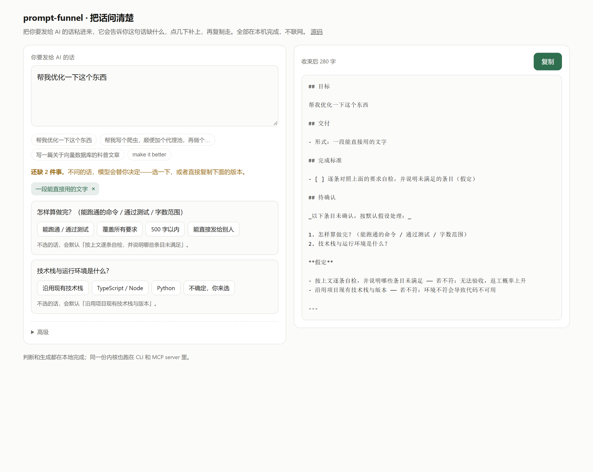
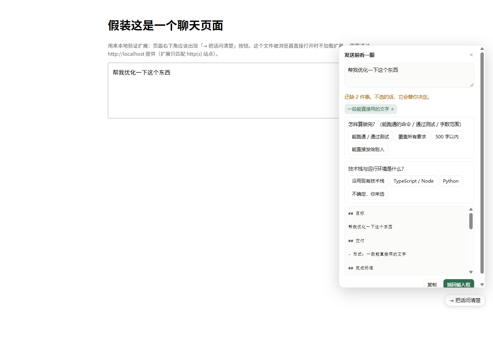

# prompt-funnel

[](https://www.npmjs.com/package/prompt-funnel)
[](https://github.com/sanyin/prompt-funnel/actions/workflows/ci.yml)
[](package.json)
[](package.json)
[](LICENSE)

> Make what a request leaves out explicit, before it reaches the model. Ask what should be asked, mark what was guessed, block what was invented.

[中文](./README.md) · [Design notes](./docs/DESIGN.md) · [Usage](./docs/USAGE.md) · [Measured](./docs/AB-REPORT.md)



Try it without installing anything: **https://sanyin.github.io/prompt-funnel/**

---

## The problem it addresses

Most "the AI answered badly" is not a wording problem. It is one of four things missing: **goal, delivery shape, constraints, acceptance**. The model will not tell you what is missing — it picks a default and hands you something that looks professional and is not what you wanted.

Same request, two outcomes:

| Sent as-is | After compiling |
| --- | --- |
| "Here is a complete, runnable solution…" | "**Because you did not name a target site**, I am using Python and httpbin.org/ip as an example…" |
| 3000 words, no mention of what was guessed | First sentence says what was decided for you |

And the defaults the model invents get written into its answer; on the next turn you treat that answer as a premise, so a guess becomes a "fact". Three turns later nobody remembers who chose the stack.

Across 60 controlled calls, "states its own assumptions" went from **5/30 to 18/30**. Method, confounds and **what this does not prove**: [docs/AB-REPORT.md](./docs/AB-REPORT.md).

## What using it feels like

Three steps: **write → fill in → copy.**

```
1. Paste: "write me a scraper, add a proxy pool too"
2. It says: "two things are still open" — click once or twice, or type your own
3. Copy, send to any model
```

No prompt-engineering to learn, nothing to install, no API key. Everything runs locally.

```bash
npx prompt-funnel review "help me make this better"    # interactive: agree, edit, send
npx prompt-funnel compile "help me make this better"   # just take the prompt
npx prompt-funnel gate   "help me make this better"    # verdict only, no changes
npx prompt-funnel ideas  "a small game, it has to feel new"  # stuck? three directions
```

Zero runtime dependencies, works offline. Node ≥ 22.

## What it does / does not do

| Does | Does not |
| --- | --- |
| Decides whether to compile at all; clear requests pass through **byte for byte** | Rewrite your wording (rewriting is where invention enters) |
| Splits goal / requirements / constraints / out-of-scope / acceptance | Decide scope, audience or stack for you |
| Turns what is missing into **questions you answer with a click**, at most three | Turn into a form |
| Offers a **one-message version** you can actually send | Push a spec sheet into a chat box |
| Checks that every number, path and identifier came from your text | Replace your words with "better" ones |
| Flags keys, phone numbers and internal addresses before they leave | **Edit your text**: you decide what to redact |
| Carries the agreed context into follow-ups | Guess what "continue" means |

---

## How it asks

**Questions are data.** Each gap is a structure with an `id`, a question and options — not a string. Picking an option writes into the field it belongs to: "a list" → deliverable, "tests pass" → acceptance, "first one only" → constraint. No model involved, no rewriting.

**Three at most.** Every extra question loses people. Three is a trade-off, not laziness.

**None of these → say it yourself.** Every question has "✎ none of these, I will say it myself". Your text goes in verbatim. A closed vocabulary always fails someone; the exit is the point.

**Multi-select where it is genuinely plural**, with a confirm step so the first pick does not dismiss the card.

**Options are ordered by what is likely.** Words from your own text first, then your last pick. Prediction belongs in ranking candidates — **not in writing content**.

**It asks what failure looks like.** Everyone asks "when is it done"; almost nobody asks "what would count as failure", so the model never avoids the trap you did not name.

**Different people get different questions.** Coursework is asked how it is marked (rubric, word limit, citations, derivation); engineering work is asked what must not be touched. "Do not change the interface" lands in out-of-scope, not in the requirements.

## How it gives

**You get one message, not a document.** The structured style looks like `## Objective` / `## Done when` / `(assumed)` — in a chat box that is a work order. So the default is `chat`:

> I want to make a small pixel game, like Minecraft, and it has to feel new. Constraint: novelty means new mechanics/rules
>
> Delivery: text I can use directly; it counts as done when it runs and passes tests; what I least want is something that does not run.
>
> Where I have not said, use these defaults: a working change plus a short note; the existing stack. Tell me if any of that is wrong.

**177 characters against 371 for the structured version.** No headings, no checkboxes, no `(assumed)` markers — but the last paragraph states every default in plain language, so a guess still cannot pass as your words. Prefer structure? `--style bluf`.

**Background and request are separated.** Paste an error log and add one line — the most common real usage. A line of `---` splits them: everything above is carried verbatim, only what is below is analysed.

**Stuck? Three directions.** A hand-written library of 26 directions across game / tool / writing / data / dev, each saying what it buys, what to watch and what it costs to try. **Not generated**: the same input always returns the same three. Picking one becomes a constraint; unpicked ones never enter the prompt.

## How it lets you ask for honesty

There is a **"tell me the truth"** toggle (`critique` on the CLI).

It does not add "please do not be sycophantic" — a model satisfies that superficially: one agreeable sentence, a turn, and the same answer. It adds checkable structure:

- conclusion first: viable / not viable / viable with conditions — no preamble
- disagree directly; no "although… but…" that turns disagreement into agreement
- say "I am not sure" where you are not sure
- name at least one concrete reason this will fail

"Do not flatter" is an attitude. "Conclusion first plus one fatal risk" is an acceptance criterion. Only the second one can be checked, and only the second one changes the output.

## Before you send, see what you are sending

The most common leak is not an attack, it is a paste: a log with `sk-...` still in it, a stack trace with `C:\Users\...`, an error message with a phone number.

Every surface scans for API keys, tokens, private keys, passwords, emails, phone numbers, ID numbers, internal IPs and local paths. When something matches it reports **how many, what kind, how long** — never the secret itself (terminal history is an attack surface too), and never an edit you did not ask for.

You decide: a per-item redaction button on the web and in the extension, `--redact` on the CLI, `--no-redact` to skip.

Patterns are deliberately narrow: ports, versions, dates, short commit hashes and order numbers are asserted as non-findings. Missing one is better than being the tool that cried wolf.

## Six ways in

| Entry | For | How |
| --- | --- | --- |
| **Web** | try it without installing | https://sanyin.github.io/prompt-funnel/ |
| **Extension** | fill the gap inside ChatGPT / Claude / DeepSeek | `npm run build:extension` ([setup](./extension/README.md)) |
| **CLI** | terminal, scripts, pipes | `npx prompt-funnel review "..."` |
| **MCP** | any agent: DSH / Codex / Claude Code / Cursor | `npx -y prompt-funnel mcp` |
| **Hook** | Claude Code, before send | `funnel hook` ([config](./adapters/claude-code/README.md)) |
| **Skill** | let the agent know when to compile | `node adapters/install.mjs codex` |



The extension does not intercept sending: it appears when you click it, and "insert back" writes the result into the composer so you send as usual.

MCP does only deterministic work (gate / analyse / validate / render); **the semantic step is done by the host's own model**, so there is no second key and no extra token spend. Seven tools:

| Tool | What it does |
| --- | --- |
| `funnel_gate` | should this be compiled at all |
| `funnel_analyze` | raw text → structured spec |
| `funnel_render` | spec → final prompt, with the fidelity check |
| `funnel_continue` | follow-up: carry the agreed turn, analyse only the increment |
| `funnel_refine` | change one section ("make point 2 shorter") |
| `funnel_ideas` | the hand-written direction library |
| `funnel_compile` | all of the above in one call |

## Four design decisions

**1. A gate, not a gateway.** Most messages are already clear; rewriting every one costs latency, tokens and trust. Clear requests pass through byte for byte — asserted by tests.

**2. The artefact is structured, not a string.** Every field records where it came from: `user` / `inferred` / `assumption`, and anything not `user` is marked when rendered.

**3. The fidelity check is deterministic.** A number, path or URL in the output that is not in the source is an error, exit code 1, CI-friendly. Do not ask the model whether it made things up — ask the source.

**4. Follow-ups continue, they do not rewrite.** "Add a test too" is meaningless out of context. `funnel continue` carries the previous goal/requirements/delivery as an "already agreed" block and analyses only the increment.

Why beginning-middle-end: models use the **beginning and end** of a context far better than the middle ([Lost in the Middle, TACL 2024](https://direct.mit.edu/tacl/article/doi/10.1162/tacl_a_00638/119630/Lost-in-the-Middle-How-Language-Models-Use-Long)), so the ask goes first and the acceptance criteria last; and **more instructions means lower compliance** ([IFScale, 2025](https://huggingface.co/papers/2507.11538)), so requirements are numbered, individually checkable, and warn past twelve instead of silently stuffing them in.

## Measured

**Offline eval** (16 hand-labelled cases, no key needed, `npm run eval`):

| Metric | Result |
| --- | --- |
| Gate agreement with human labels | 16/16 |
| Median content-word retention | 100% |
| Invented literals | 0 |
| Median length cost | 18 → 304 tokens (`chat` is lower) |

**Live A/B** (deepseek-chat, 60 calls): assumptions stated 5/30 → 18/30, self-check phrasing 2/30 → 17/30, about +258 input tokens per call. Full write-up and what cannot be concluded: [docs/AB-REPORT.md](./docs/AB-REPORT.md).

**Cost**: roughly **+119 to +299 tokens** depending on style. `funnel compile --budget 150` degrades the layout automatically and says so.

**Tests**: 149 unit tests, reproducible with `npm test`.

## Layout

```
src/
  gate.ts        the gate: six weighted axes, verdict + plain-language reason
  analyze.ts     extractive analysis: reorders, never rewrites
  questions.ts   gaps as clickable questions; answers fold into fields
  seeds.ts       hand-written direction library
  redact.ts      secret/PII scan
  refine.ts      single-point edits
  session.ts     follow-up continuation
  templates.ts   intent templates
  render.ts      four layouts (chat / bluf / compact / checklist)
  validate.ts    fidelity check + spec normalisation
playground/      one static page running the same core
extension/       Chromium MV3, imports dist/ directly, requests no permissions
adapters/        Codex / DSH / Claude Code skills and installers
evals/           offline cases, live A/B harness, cost measurement
```

## Known limits

**Ceiling of a rules engine**

- It **does not understand meaning**; it reads markers, so colloquial Chinese slips past (a miss never becomes an invention, it shows up as lower retention).
- **Intent can be misclassified**: a course paper about databases was once read as a coding task because of the word "database". These get fixed one at a time.
- A sentence mixing a constraint and an action is not split.
- `refine` understands eight sentence shapes; when it cannot parse, it says so.

**Options and interaction**

- **The options are hand-written**, not learned from usage. That is deliberate: collecting request text would destroy the premise of the tool, so there is no, and will not be, "smarter the more people use it".
- Three questions is a trade-off; more complex requests get flattened.
- A continuation is splice + summary, not dialogue understanding.

**Limits of the evidence**

- The live A/B covers **one model, 10 cases, 3 samples**, and the quality dimension has **no human blind rating yet**. "Better answers" is a directional hint, not a result.
- The Claude Code hook is confirmed to receive correct payloads in milliseconds, but **whether the injected context is used by the model is not measured**.
- **Secret detection is regex-based**: common formats only, nothing bespoke. It prefers missing a value to raising a false alarm.
- **The extension was only verified against a local fixture page**; its composer heuristic depends on page structure and may break when a site changes.

## Contributing

See [CONTRIBUTING.md](./CONTRIBUTING.md). The most valuable contributions are **eval cases**, **directions for domains you know**, and **rating `rating.csv`**.

## License

MIT
