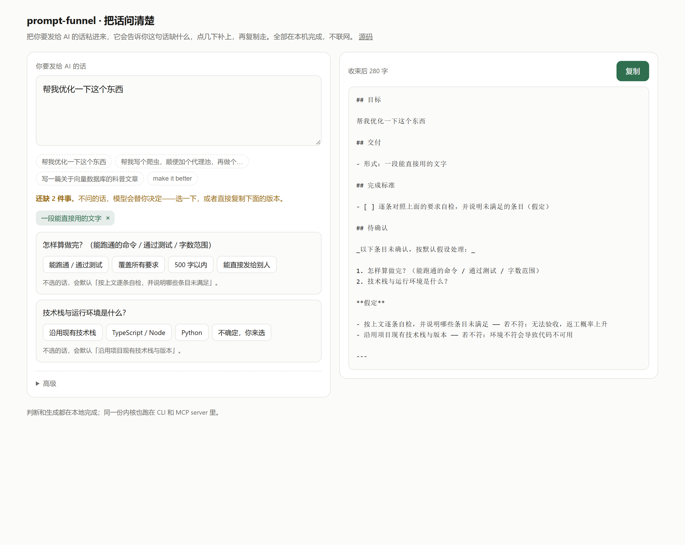
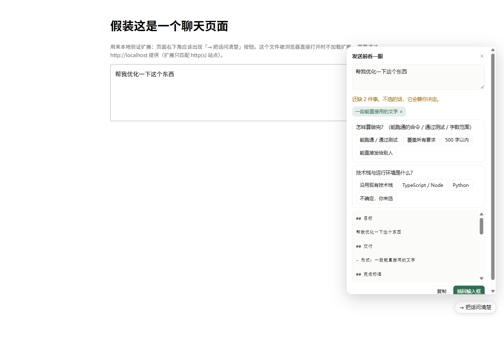

# prompt-funnel · 收束

[](https://www.npmjs.com/package/prompt-funnel)
[](https://github.com/sanyin/prompt-funnel/actions/workflows/ci.yml)
[](package.json)
[](package.json)
[](LICENSE)

> 在请求进入模型之前，把缺的信息显式化。该问的就问，猜的就标出来，编的一律拦掉。

[English](./README.en.md) · [设计说明](./docs/DESIGN.md) · [用法](./docs/USAGE.md) · [实测](./docs/AB-REPORT.md)



在线试用（无需安装）：**https://sanyin.github.io/prompt-funnel/**

---

## 它解决的是哪一件事

大多数「AI 答不好」，不是措辞问题，是**目标、交付形态、约束、验收标准**四件事里缺了一两件。模型不会说它缺什么——它会自己补一个，然后给你一份看起来很专业、但不是你要的答案。

同一个请求「帮我写个爬虫，顺便加个代理池，再做个面板」，两种结果：

| 直接发 | 收束后发 |
| --- | --- |
| 「下面给你一套可直接运行的完整方案……」 | 「**由于你未指定目标网站**，我采用 Python 技术栈，以 httpbin.org/ip 作为示例目标……」 |
| 3000 字实现，不说哪里是猜的 | 第一句就交代了哪些是替你决定的 |

而且，**模型替你补的默认值会被写进回答**；下一轮你把那个回答当作前提，猜测就变成了「事实」。三步之后没人记得技术栈是谁选的。

在 60 次受控调用里，「明确说出自己的假设」从 **5/30 提到 18/30**。完整方法、混杂因素和**不能证明什么**都在 [docs/AB-REPORT.md](./docs/AB-REPORT.md)。

## 用它是什么感觉

三步：**写下 → 补全 → 复制**。

```
1. 粘一句：「帮我写个爬虫，顺便加个代理池」
2. 它说：「还缺 2 件事」——点一两下，或者自己写
3. 复制走，发给任何模型
```

不需要学提示词工程，不需要装东西，不需要 API key。全部在本机算完。

```bash
npx prompt-funnel review "帮我优化一下这个东西"    # 交互式：改到满意再发
npx prompt-funnel compile "帮我优化一下这个东西"    # 直接拿提示词
npx prompt-funnel gate   "帮我优化一下这个东西"    # 只看判定，不改
npx prompt-funnel ideas  "我想做个小游戏，要有新意"  # 卡壳时给三条方向
```

零运行时依赖，离线可用。Node ≥ 22。

## 它做什么 / 不做什么

| 会做 | 不会做 |
| --- | --- |
| 判定要不要收束，清晰的**逐字节原样放行** | 不润色你的措辞（改写是编造的主要来源） |
| 拆出目标 / 要求 / 约束 / 非目标 / 验收 | 不替你决定范围、受众、技术栈 |
| 把缺失变成**点一下就答的问题**，最多 3 个 | 不做问卷，不要求你写作文 |
| 提供能直接发出去的**一句话版本** | 不把工单塞进聊天框 |
| 校验输出里的数字、路径、标识符是否来自原文 | 不用「更好的措辞」换掉你的原话 |
| 扫出要发出去的密钥、手机号、内网地址 | **不替你改字**：打不打码你决定 |
| 追问时带上已确认的上下文 | 不猜「继续」是什么意思 |

---

## 它怎么问

**问题即数据。** 每个缺口是一个带 `id / 问题 / 选项` 的结构，不是一个字符串。你点选项，答案**写回对应字段**：选「一份清单」→ 交付物；选「能跑通」→ 完成标准；选「先做第一件」→ 约束。不经过模型，不重写你的字。

**最多 3 个。** 每多一个问题，就有更多人中途放弃。三个是取舍结果，不是省事。

**答不上来就自己说。** 每个问题下面都有「✎ 都不是，我自己说」——点开就地输入，你的原话**一字不改**进提示词。封闭选项集必然在某个人身上失效，出口才是解。

**能多选的标着「可多选」。** 新意落在哪几轴、要什么交付物、什么算失败，本来就可能是好几项。选完点「就这些 ✓」才收起。

**选项按可能性排序。** 你原话里出现过的词排前面，上次选过的其次。这是把「预测」用在能验证的地方——**给候选排序，而不是替你写内容**。

**问「要它扮演谁」。** 调试、规划、问答类请求会多一句。选项里有个「完全不懂这块的人」——用来检查你这段话是不是只有内行才看得懂。选「不需要」就不会写进提示词。

**问「直接做还是先计划」。** 复杂任务可以先要计划或两三个方案对比，再让它动手。

**问「什么算失败」。** 「怎样算做完」人人会问，「什么算失败」几乎没人问，但模型不会主动避开你没说过的坑。选前三个会变成一条反面验收标准（`不出现：做出来不能用`）。

**分人群问不同的事。** 课程作业问「按什么标准评」（评分表 / 字数 / 引用格式 / 推导过程 / 不许像 AI 写的）；工程任务问「有什么是不能动的」（不许改接口 / 不加依赖 / 不动数据库 / 先别写代码）。**「不许动 X」进「不要做」，不进「要求」**——约束和任务要分开摆。

## 它怎么给

**默认给你一句能直接发的话，不是一份文档。** 分节版长这样：`## 目标` `## 完成标准` `（假定）`——对着聊天框，那是工单。所以默认用 `chat` 排版：

> 我想做一个像素小游戏，类似我的世界，要有新意。约束：「新意」的落点：玩法 / 规则上的新
>
> 交付：一段能直接用的文字；做到这些就算完成：能跑通 / 通过测试；我最不想要的是做出来不能用。
>
> 没说的地方我先按这几条处理：可运行的改动 + 简短的变更说明；沿用项目现有技术栈与版本。不对的话告诉我，我改。

**177 字，是分节版（371 字）的一半不到。** 没有标题、没有勾选框、没有 `（假定）` 标记——但最后一段把默认值用大白话说了出来，所以猜测依然不会冒充你的话。想要结构化版本：`--style bluf`。

**背景资料和需求分开。** 粘一段报错日志再补一句需求，是最常见的真实用法。用一行 `---` 分开：

```
TypeError: x is not a function
    at app.ts:12
---
帮我看看为什么报错
```

`---` 上面原样带上当背景，下面才被解析成需求。

背景一长，就会被包进 XML 标签——`---` 是给人看的约定，而模型是吃标记训练出来的：

```
<context>
TypeError: x is not a function
    at app.ts:12
</context>

帮我看看为什么报错
```

多段背景各自包一层 `<document>`。**标签里不加编号**：`index="1"` 那种写法会被保真校验当成「原文里没有的数字」，而顺序本来就是对的。

**可以给一组例子。** 页面底部有「输入 → 输出」，比任何形容词都更能说明你要什么。这是文献里效果最稳的一招。

**卡壳时给三条方向。** 手写方向库，26 条，覆盖游戏 / 工具 / 写作 / 数据 / 研发。每条写明「买到什么、注意什么、成本多高」，有稳定 id 可追溯。**不是 AI 生成的**：同样的输入永远给同样的三条。选中一条会变成约束（`方向参考：…`），没选中的永不进提示词。

## 它怎么让你敢说真话

页面上有个 **「要它说实话」** 开关（CLI / 模板里叫 `critique`）。

它不是加一句「请不要谄媚用户」——那句话模型很容易表面满足：先来一句"你说得很有道理"，再转折，最后还是顺着说。它加的是**可检查的结构**：

- 第一句就给结论：可行 / 不可行 / 有条件可行，不许先铺垫
- 不同意的直接说，不许用「虽然…但是」把反对意见包装成同意
- 不确定就说「不确定」，不许用笃定的措辞填空
- 至少指出一个会让它失败的具体原因

「别谄媚」是态度，「先给结论 + 至少一个致命风险」是验收标准。**只有后者能被检查，也只有后者会真的改变输出。**

## 发送前，先看清要发出去的是什么

普通人最常见的泄露不是黑客攻击，是**粘贴**：把带 `sk-...` 的日志、带手机号的报错、带 `C:\Users\...` 的堆栈直接发了出去。

所有入口都会扫一遍：API 密钥 / 令牌 / 私钥 / 密码 / 邮箱 / 手机号 / 身份证号 / 内网地址 / 本机路径。命中就告诉你**几处、什么类型、多长**——但**不会把密钥本身打印出来**（终端历史也是泄露面），也**不会自作主张改你的字**。

要不要打码由你决定：网页上逐条「打码」，CLI 用 `--redact`，不想扫就 `--no-redact`。

规则写得保守：端口、版本号、日期、commit 短哈希、订单号都不会误报，测试里有反例断言。宁可漏一个，也不当那个喊狼来了的人。

## 六种入口

| 入口 | 适合 | 怎么用 |
| --- | --- | --- |
| **网页** | 不装任何东西，先用一眼 | https://sanyin.github.io/prompt-funnel/ |
| **浏览器扩展** | 在 ChatGPT / Claude / DeepSeek 里直接补 | `npm run build:extension`（[安装](./extension/README.md)） |
| **CLI** | 终端、脚本、管道 | `npx prompt-funnel review "..."` |
| **MCP** | 任何 agent：DSH / Codex / Claude Code / Cursor | `npx -y prompt-funnel mcp` |
| **Hook** | Claude Code 发送前自动收束 | `funnel hook`（[配置](./adapters/claude-code/README.md)） |
| **Skill** | 让 agent 自己知道何时该收束 | `node adapters/install.mjs codex` |



扩展不拦截发送：你点它，它才出现；点「插回输入框」，它把结果写回去，你照常按发送。

MCP 只做确定性的事（判定 / 分析 / 校验 / 渲染），**语义工作交给宿主自己的模型**：不需要第二个 key，也不额外花 token。七个工具：

| 工具 | 作用 |
| --- | --- |
| `funnel_gate` | 要不要收束 |
| `funnel_analyze` | 原话 → 结构化 spec |
| `funnel_render` | spec → 最终提示词（带保真校验） |
| `funnel_continue` | 追问：带上已确认的上一轮，只做本轮增量 |
| `funnel_refine` | 定点改一处（「第 2 点改成 X」） |
| `funnel_ideas` | 手写方向库：卡壳时给三条候选 |
| `funnel_compile` | 一步到位 |

## 四个设计决定

**1. 闸门，不是网关。** 大部分消息本来就清楚，逐条重写要付延迟、token 和信任三重代价。清晰的请求原样放行——字节相同，有测试断言。

**2. 产物是结构化对象，不是字符串。** 每个字段都记着来源：`user`（你说的）/ `inferred`（规则推的）/ `assumption`（默认值）。渲染时非 `user` 的一律标出来。

**3. 保真校验是确定性的。** 输出里出现原文没有的数字、路径、URL → 直接 error，退出码 1，能进 CI。不问模型「你有没有编」，问原文。你在 `refine` 里新写的字面量会被记进 `meta.note` 放行——那是你的输入，不是编造。

**4. 追问不重写，而是续接。** 「再补个测试」脱离上文没有意义。`funnel continue` 把上一轮的目标/要求/交付作为「已确认」块放进新提示词，只分析本轮的增量。

为什么是「总—分—总」：模型对上下文**首尾**的利用率显著高于中部（[Lost in the Middle, TACL 2024](https://direct.mit.edu/tacl/article/doi/10.1162/tacl_a_00638/119630/Lost-in-the-Middle-How-Language-Models-Use-Long)），所以「要做什么」放最前、「怎样算做完」放最后；而**指令越多遵循率越低**（[IFScale, 2025](https://huggingface.co/papers/2507.11538)），所以要求必须编号、单条可验证，超过 12 条明确警告而不是硬塞。完整论证在 [docs/DESIGN.md](./docs/DESIGN.md)。

## 工作方式

```
用户原文 ──▶ 敏感信息扫描 ──▶ 闸门 gate ──pass──▶ 原样发送（字节相同）
                │                  │
          命中就报，不自动改     compile
                │                  ▼
                │        结构化为 PromptSpec（每条带来源）
                │          rules：抽取式，离线，默认
                │          api  ：可选，语义改写，仍要过校验
                │                  ▼
                │          + 模板 / + 上一轮已确认 / + 手写方向
                │                  ▼
                │          渲染 chat / bluf / compact / checklist
                │                  ▼
                │          保真校验：硬字面量 + 保留率
                ▼                  ▼
         逐条「打码」       评审：点答问题 / 自己写 / 看差异
                                   ▼
                              发送
```

## 实测

**离线评测**（16 条手工用例，不需要 key，`npm run eval`）：

| 指标 | 结果 |
| --- | --- |
| 闸门与人工标注一致率 | 16/16 |
| 原文内容词保留率（中位） | 100% |
| 未溯源字面量（编造） | 0 |
| 长度开销（中位） | 18 → 304 tokens（`chat` 排版更低） |

**真实模型 A/B**（deepseek-chat，60 次调用）：假设外显 5/30 → 18/30，自检表述 2/30 → 17/30，每条多约 258 输入 tokens。全文与不可证明的部分见 [docs/AB-REPORT.md](./docs/AB-REPORT.md)。README 里不放没测过的数字。

**成本**：绝对开销约 **+119 ~ +299 tokens**（取决于排版），默认档最贵。实测表、三档做法和「什么时候别用」在 [docs/COST.md](./docs/COST.md)。`funnel compile --budget 150` 会在超预算时自动降级并告诉你。

**测试**：149 条单元测试，`npm test` 可复现。

## 目录

```
src/
  gate.ts        闸门：六维加权，判定 + 人话理由
  analyze.ts     抽取式分析：只重排不改写；缺口带 id/问题/选项/多选
  questions.ts   把缺口变成可点选的问题，答案写回对应字段
  seeds.ts       手写方向库：卡壳时的三条候选
  redact.ts      敏感信息扫描：密钥 / 手机号 / 内网地址 / 本机路径
  refine.ts      单点修改：第 2 点改成 X / 再加一条 / 删掉
  session.ts     追问续接：把已确认的一轮带进下一轮
  templates.ts   意图模板：为特定任务补上缺的验收标准
  render.ts      四种排版（chat / bluf / compact / checklist）
  validate.ts    保真校验 + spec 归一化
  hook.ts        Claude Code 发送前钩子（advisory / block / off）
  llm.ts         可选 API 引擎（OpenAI 兼容）
  cli/           compile / review / refine / continue / gate / render / templates / ideas / hook
  mcp/           stdio MCP server（零依赖实现，7 个工具）
playground/      单页问答器：浏览器里直接跑同一份内核
extension/       Chromium MV3 扩展：从 dist/ 直接 import 内核，无权限申请
adapters/        Codex / DSH / Claude Code 的 skill、安装脚本与配置说明
evals/           16 条离线用例 + 真实模型 A/B harness + 成本测量
docs/            DESIGN / SPEC / USAGE / EVAL / AB-REPORT / COST / EXAMPLE
```

## 已知局限

**规则引擎的天花板**

- **不理解语义**，靠标记词判断，中文口语会漏标（漏了不会编造，会在保真率里露出来）。
- **意图会判错**：`帮我写一篇关于向量数据库的课程论文` 曾因为出现「数据库」被判成改代码。这类误判只能一个个修，修一个少一个。
- 一句里同时有约束和动作时不拆（「用 TypeScript 重写这个模块」），整句留在「要求」里。
- `refine` 只认 8 种固定句式；看不懂时直接列出来，不猜。

**选项与交互**

- **选项是我手写的**，不是从你的使用里学出来的。覆盖不到的地方只能靠「我自己说」兜底——这是有意为之：**收集你的请求原文会毁掉这个工具的前提**，所以没有、也不打算有「用的人越多越聪明」。
- 每题最多 3 个问题，是取舍；更复杂的需求会被压平。
- 追问续接是「拼接 + 摘要」，不做真正的对话理解；超过几轮后 `已确认` 块会变长，需要手动精简。

**验证的边界**

- 真实 A/B 只测了**一个模型、10 个用例、3 次采样**，且质量维度**尚未人工盲评**。所以「答案更好」目前只有方向性证据，没有结论。
- Hook 装在 Claude Code 上：已确认它会以正确 payload 调用 `UserPromptSubmit`，响应在毫秒级；**但「注入的内容是否被模型采用」没有量化验证**。
- **敏感信息靠正则**：能抓常见格式，抓不到你们内部自定义的密钥格式。宁可漏报也不误报——被假警报训练出来的「无脑点忽略」比漏一个更危险。
- **浏览器扩展只在本地假页面验证过**（`extension/test/fixture.html`），没在真实站点上验证；「找输入框」依赖页面结构，站点改版可能失效（表现是按钮没反应，不会破坏页面）。

## 参与

见 [CONTRIBUTING.md](./CONTRIBUTING.md)。最有价值的贡献是**加评测用例**、**往方向库里加你所在领域的方向**，以及**评完 `rating.csv`**。

## License

MIT
