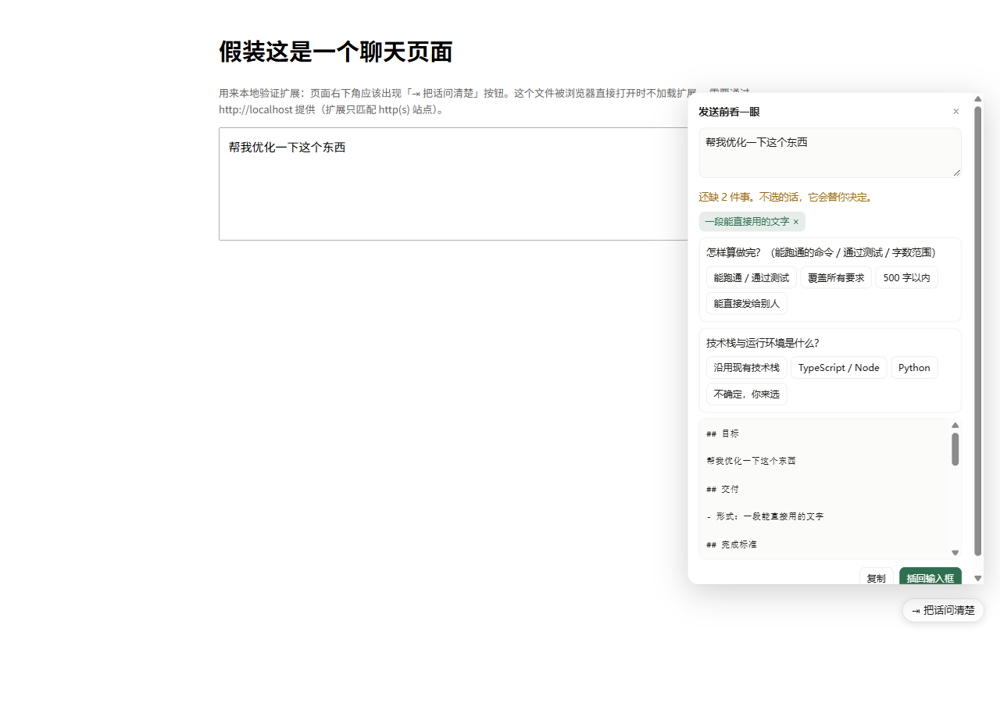

# 浏览器扩展

在 ChatGPT / Claude / DeepSeek / Kimi / 豆包 / Gemini 的输入框旁边加一个按钮：发送前告诉你这句话缺什么，点两下补上，再插回输入框。



## 安装

```bash
npm run build          # 先构建内核
npm run build:extension
```

然后 Chrome / Edge：

1. 打开 `chrome://extensions`
2. 右上角打开「开发者模式」
3. 点「加载已解压的扩展程序」，选这个 `extension/` 目录

没有上架商店，所以只能这样装。上架需要开发者账号和审核，不是技术问题。

## 它做什么

- 你点按钮 → 面板里出现当前输入框的内容
- 「还缺 2 件事」+ 每件事两三个选项
- 选完，下面的提示词实时更新
- 「插回输入框」把结果写回原来的输入框，你正常按发送

**它不拦截你的发送**，也不会在你打字时弹东西。你没点它，它就不存在。

## 顺带检查敏感信息

面板会扫一遍你粘贴的内容：API 密钥、令牌、私钥、密码、手机号、身份证号、内网地址、本机路径。命中就标黄，并告诉你有几处——**它不会自动改你的字**，要不要打码由你决定。

这条在扩展里尤其重要：大多数人是在粘贴报错日志时，把带 token 的那行一起粘进去的。

## 局限

- **改写不了富文本编辑器的极端情况**：ChatGPT / Claude 用 ProseMirror，走的是「全选 + 插入文本」，绝大多数情况可用；如果有站点把编辑器放在 iframe 里，会提示「没找到输入框」。
- **站点改版会失效**：按钮是注入的固定元素，通常不受影响；但「找输入框」的逻辑依赖页面结构，改版可能需要更新。
- **没有联网、没有权限申请**：`permissions` 和 `host_permissions` 都是空的，全部在本地算。
- 只在 Chromium 系浏览器测过，Firefox 需要改 `manifest` 的 `background` 写法。

## 本地验证

`extension/test/fixture.html` 是一个假的聊天页：

```bash
cd extension/test && python -m http.server 8095
# 浏览器打开 http://127.0.0.1:8095/fixture.html
```

扩展的 `matches` 里包含 `http://localhost/*` 和 `http://127.0.0.1/*`，所以在这个页面上也能用。
